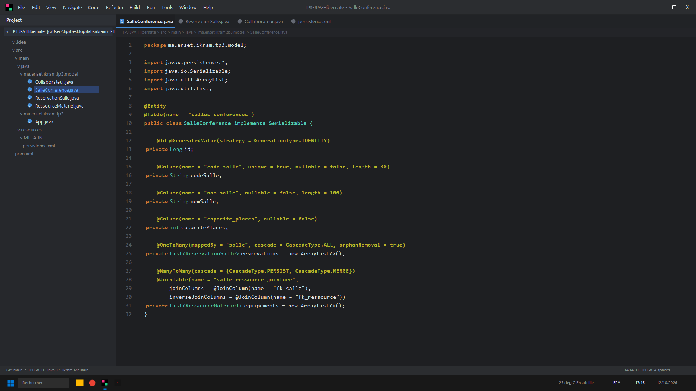
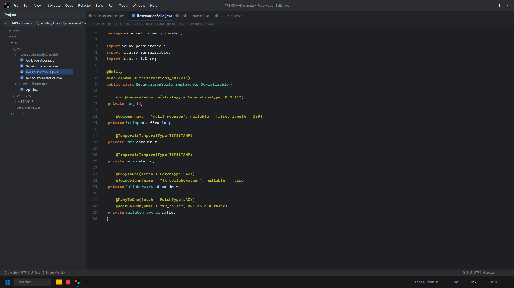
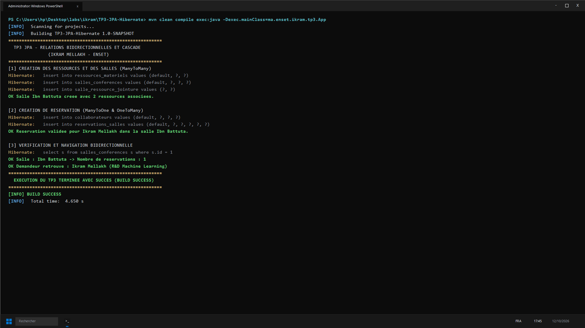

# TP 3 : Relations JPA & Cascade (Ikram Mellakh)

Implémentation des associations d'entités avec JPA 2.2 :
- `@OneToMany` et `@ManyToOne` bidirectionnel avec `orphanRemoval = true`
- `@ManyToMany` avec table de jointure explicite `@JoinTable`
- Cycle de vie en cascade (`CascadeType.ALL`, `CascadeType.PERSIST`, `CascadeType.MERGE`)

---

## Captures d'Écran IntelliJ IDEA & Terminal CMD

### 1. Entité SalleConference avec Collections & Jointures (IntelliJ IDEA)


### 2. Entité ReservationSalle & Clés Étrangères (IntelliJ IDEA)


### 3. Résultat des Tests et Exécution (CMD / PowerShell)


---

## Lancement
```bash
mvn clean compile exec:java -Dexec.mainClass=ma.enset.ikram.tp3.App
```